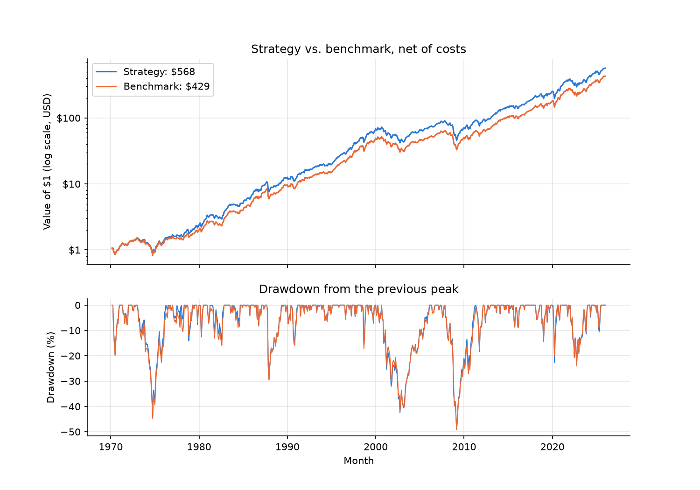
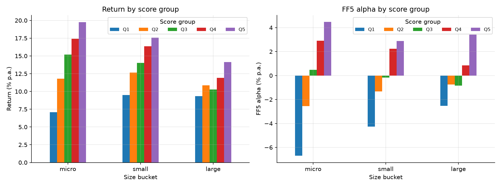
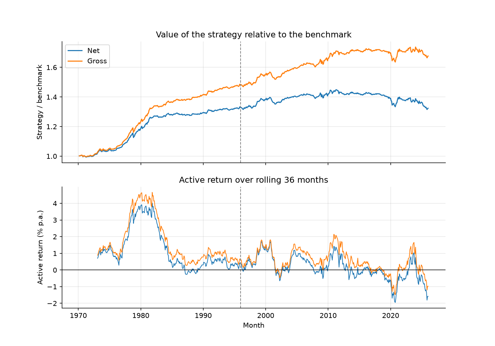
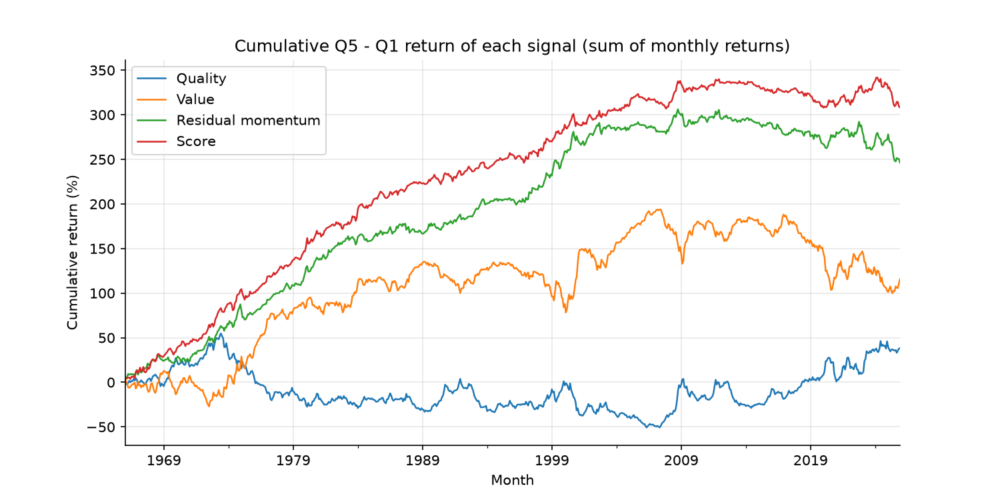
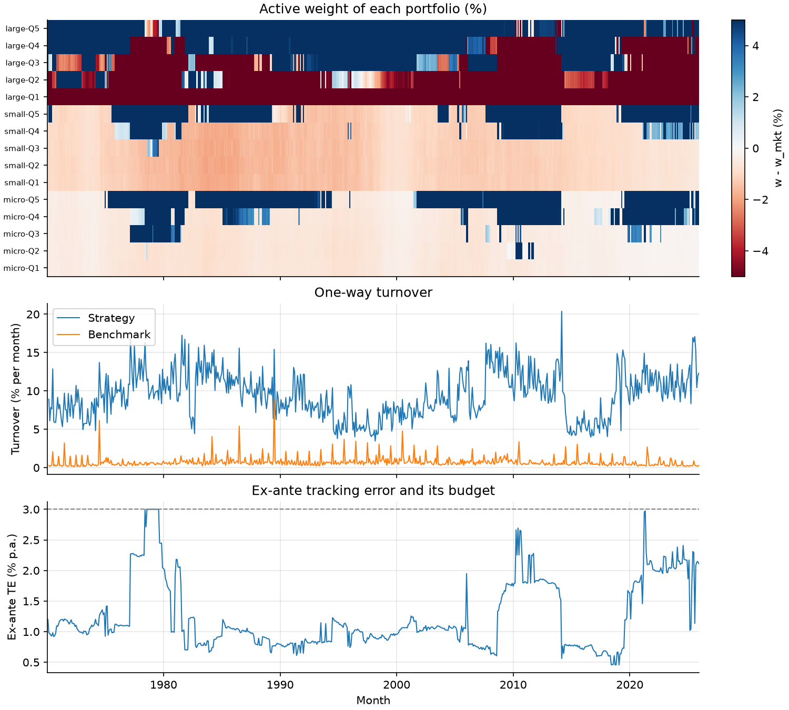
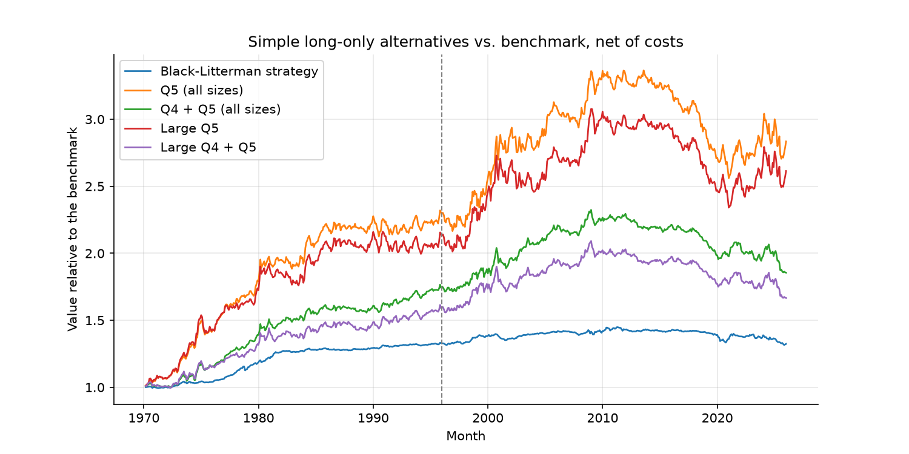

# Quality, Value & Residual Momentum — A Black-Litterman Tilt on US Equities

### Long-only, benchmark-relative allocation across 15 size × score portfolios, 1970–2025

Group project — Applied Investments (Prof. Amit Goyal), HEC Lausanne, MSc in Finance, 2026–27.



## Overview

This project builds a monthly US equity strategy from a composite stock-selection score and asks whether a realistic, long-only, benchmark-relative portfolio can harvest it after trading costs.

Each month, US common stocks are ranked **within their sector** on a score combining three ingredients:

- **Quality** — six accounting ratios (ROE, ROA, gross margin, debt-to-equity, current ratio, gross profitability);
- **Value** — book-to-market;
- **Residual momentum** — past returns not explained by the Fama-French 3 factors (Blitz, Huij & Martens, 2011).

Stocks are grouped into **15 value-weighted portfolios** (3 size buckets × 5 score quintiles). A **Black-Litterman** model expresses one view per size bucket — high-score stocks beat low-score stocks — and an optimiser tilts the portfolio away from market weights, subject to a long-only constraint, a ±5% active-weight limit per portfolio and a 3% tracking-error budget. The benchmark is the value-weighted portfolio of the same universe.

The backtest is fully point-in-time: a decision taken at the end of month *t* uses only information available at *t* and earns the return of month *t + 1*. All results are **net of trading costs** unless stated otherwise; all t-statistics use Newey-West standard errors (6 lags).

**Research question:** Is there information in a quality–value–momentum score, and can a constrained benchmark-relative portfolio transfer it into net alpha?

**Answer, in short:** The signal is strong in the cross-section (FF5 alpha of 5.9% p.a., t = 5.6), but little of it reaches the portfolio. The strategy beats its benchmark by 0.53% p.a. net (t = 2.75), mostly through known factors and almost entirely before 1996.

## Data

- **CRSP monthly stock file** (CIZ format, WRDS) — returns incl. delisting returns, prices, shares outstanding, dividends, SIC codes, share and exchange descriptors, 1963–2025.
- **CRSP/Compustat Merged, annual** (WRDS) — IB, CEQ, TXDITC, AT, REVT, COGS, DLC, DLTT, ACT, LCT, fiscal years 1963–2026.
- **Kenneth French Data Library** — Mkt-RF, SMB, HML, RMW, CMA, UMD, RF and the Fama-French 12 industry definitions (downloaded automatically by the notebook).
- **Universe:** US-incorporated common stocks on NYSE / AMEX / NASDAQ with price ≥ $5 and complete accounting data — 23,717 stocks over 756 months, **~2,600 stocks per month** on average.
- **Sample:** strategy from February 1970 to December 2025 (671 months); signal sorts from January 1966.

CRSP and Compustat data are licensed through WRDS and are **not included** in this repository — see [Data access](#data-access).

## Methodology

1. **Data cleaning** — one row per stock-month, delisting returns moved to *t + 1* (2,107 stock-months), trading halts filled from the next available price (283 stock-months), no survivorship bias.
2. **Accounting timing** — a fiscal-year report is used only 6 months after year-end, for at most 12 months; firms enter from their second year in Compustat (backfill bias).
3. **Signals** — every ratio is winsorised at 1% and turned into a z-score within its sector and month; quality, value and residual momentum are combined and re-standardised into a single score.
4. **Size buckets** — micro / small / large using the 20th and 50th NYSE market-cap percentiles.
5. **15 portfolios** — 3 size buckets × 5 score quintiles, value-weighted; held at market weights they replicate the benchmark exactly.
6. **Black-Litterman** — 60-month covariance, equilibrium returns Π = δΣw<sup>mkt</sup> (δ = 2.5, τ = 1/60), one graded view per size bucket: Q5 − Q1 + ½(Q4 − Q2) earns 4% p.a.
7. **Optimisation** — maximise the BL alpha (μ − Π)ᵀ(w − w<sup>mkt</sup>), long-only, |w − w<sup>mkt</sup>| ≤ 5%, ex-ante tracking error ≤ 3%, solved monthly with `cvxpy` (Clarabel).
8. **Implementation** — stock weights inside each portfolio, drifted weights, one-way trading costs of 50 / 25 / 10 bps for micro / small / large stocks (the benchmark pays them too).
9. **Evaluation** — performance, risk statistics, CAPM / FF3 / FF5 / FF5 + UMD alphas, factor loadings, sub-periods (up to 1995 vs. from 1996), decades and market states, robustness checks and simple long-only alternatives.

## Key results

### 1. The score predicts returns

| Q5 − Q1 sort (% p.a.) | Spread | FF5 alpha | FF5 + UMD alpha |
|---|---|---|---|
| Quality | 0.64 (0.42) | 3.98 (3.89) | 3.39 (3.39) |
| Value | 1.93 (0.98) | −1.09 (−0.86) | 1.33 (1.20) |
| Residual momentum | 4.10 (3.42) | 4.43 (3.41) | 1.88 (1.56) |
| **Composite score** | **5.14 (4.83)** | **5.90 (5.56)** | **4.58 (4.32)** |

*Newey-West t-statistics in parentheses.*



Alphas are negative for low-score groups and positive for high-score groups in **every** size bucket — but most of the signal's alpha sits in micro and small caps, which make up only ~8% of the benchmark.

### 2. Strategy vs. benchmark

| Net of costs | Whole period | Up to 1995 | From 1996 |
|---|---|---|---|
| Return (% p.a.) | 12.63 | 14.02 | 11.42 |
| Benchmark return (% p.a.) | 12.09 | 12.91 | 11.39 |
| Volatility (%) | 15.62 | 15.60 | 15.66 |
| Sharpe ratio | 0.53 | 0.46 | 0.58 |
| Active return (% p.a.) | **0.53 (t = 2.75)** | 1.11 (t = 4.17) | 0.03 (t = 0.12) |
| Tracking error (%) | 1.33 | 1.21 | 1.42 |
| Information ratio | 0.40 | 0.92 | 0.02 |
| FF5 + UMD alpha (% p.a.) | 0.20 (t = 1.07) | 0.41 (t = 1.50) | −0.14 (t = −0.52) |
| Max drawdown (%) | −49.2 | −43.6 | −49.2 |



- **Little of the signal reaches the portfolio.** The ±5% active limit and the long-only constraint bind every month; the realised tracking error is only 1.3% against a 3% budget.
- **Trading costs take about half of the active return:** 0.96% p.a. gross vs. 0.53% net.
- **The active return is mostly known factors and concentrated before 1996.** It loads on HML (and on UMD before 1996); the FF5 + UMD alpha is not significant net of costs, and the active return is about zero from 1996 — even gross of costs.
- **A simpler portfolio transfers more of the signal.** Holding only the top score quintile, value-weighted, earns 1.9% p.a. active net of costs with a significant FF5 + UMD alpha (1.8%, t = 2.8), at the cost of higher tracking error and the same information ratio (see [Extensions](#extensions-beyond-the-baseline)).



## Extensions beyond the baseline

On top of the required implementation, I added several analyses to understand *why* the strategy delivers what it does, rather than only reporting its performance.

### 1. Design improvements (v2), each behind a switch

Every change is a flag in the notebook (`QUALITY_GP`, `USE_RESMOM`, `GRADES`, `TE_TARGET`), so its effect can be tested one at a time against the original specification.

| Change | Why |
|---|---|
| **Gross profitability** (Novy-Marx, 2013) instead of sales growth in the quality score | High sales growth predicts *lower* returns (Lakonishok, Shleifer & Vishny, 1994), so it was working against the score |
| **Residual momentum** (Blitz, Huij & Martens, 2011) added as a third signal | Momentum net of FF3 exposures, weakly correlated with quality (−0.09) and value (−0.06) |
| **Graded views** Q5 − Q1 + ½(Q4 − Q2) instead of Q5 − Q1 | The middle quintiles carry information too |
| **Alpha-maximising optimiser** under a TE budget (Grinold & Kahn) instead of mean-variance utility | With τ = 1/60 the posterior barely moves from Π, so the original optimiser used only a small part of the TE budget |

### 2. Where does the signal come from?

Each component is sorted on its own (table in [Key results](#1-the-score-predicts-returns)). **Quality is the strongest component once factors are controlled for** (FF5 + UMD alpha 3.4%, t = 3.4), while residual momentum loses more than half of its alpha when UMD is added: it is less independent from plain momentum than intended.

### 3. Diagnosing the transfer: which constraint binds?

| Diagnostic | Value |
|---|---|
| Months with an active weight at the ±5% limit | 100% |
| Months with a portfolio at zero weight (long-only) | 100% |
| Months with ex-ante TE at the 3% budget | 2.1% |
| Average ex-ante TE | 1.24% |
| Turnover (% per month): strategy / benchmark | 9.4 / 0.7 |
| Trading costs (% p.a.): strategy / benchmark | 0.45 / 0.03 |

The active-weight limit and the long-only constraint, not the TE budget, are what stop the signal from reaching the portfolio.



### 4. Robustness: one change at a time

| Variant (net) | Active (% p.a.) | Active from 1996 | TE (%) | FF5 + UMD alpha | Short (%) |
|---|---|---|---|---|---|
| Base | 0.53 (2.75) | 0.03 (0.12) | 1.33 | 0.20 (1.07) | 0 |
| Active limit 2.5% | 0.24 (2.17) | −0.07 (−0.49) | 0.76 | 0.08 (0.73) | 0 |
| Active limit 10% | 0.91 (2.90) | 0.20 (0.45) | 2.08 | 0.44 (1.55) | 0 |
| TE budget 2% | 0.51 (2.77) | 0.06 (0.22) | 1.26 | 0.22 (1.26) | 0 |
| Ledoit-Wolf covariance | 0.58 (3.19) | 0.13 (0.49) | 1.25 | 0.28 (1.64) | 0 |
| Rolling view (60-month realised) | 0.35 (1.43) | −0.30 (−0.91) | 1.65 | −0.02 (−0.10) | 0 |
| Short selling allowed | 0.64 (2.20) | −0.33 (−0.89) | 1.98 | 0.37 (1.44) | 22.2 |

- The active return scales almost linearly with the active limit, which confirms that this limit binds. Cutting the TE budget to 2% changes nothing.
- Ledoit-Wolf shrinkage helps slightly and is the only variant with a borderline FF5 + UMD alpha (t = 1.64).
- A rolling view follows the decay of the signal and weakens the strategy.
- Allowing short selling (22% shorts, in low-score micro and small caps) barely helps, and borrowing costs are not even modelled.
- **No variant gives a significant FF5 + UMD alpha at 5%, or a significant active return after 1995.** The variants were reported for information only; the main specification was not changed after seeing them, to avoid data snooping.

### 5. Is Black-Litterman needed? Simple Q5 portfolios

As a benchmark for the optimiser, I tested simple rules without Black-Litterman: hold only the best score groups, value-weighted, with the same trading costs and the same evaluation.

| Portfolio (net) | Return (% p.a.) | Active | Active gross | Active from 1996 | TE (%) | IR | FF5 + UMD alpha | Turnover (%/month) | Costs (% p.a.) |
|---|---|---|---|---|---|---|---|---|---|
| Black-Litterman strategy | 12.63 | 0.53 (2.75) | 0.96 (4.86) | 0.03 (0.12) | 1.33 | 0.40 | 0.20 (1.07) | 9.4 | 0.45 |
| **Q5 (all sizes)** | **14.01** | **1.92 (3.08)** | 2.82 (4.52) | 0.79 (0.93) | 4.77 | 0.40 | **1.77 (2.77)** | 33.0 | 0.93 |
| Q4 + Q5 (all sizes) | 13.20 | 1.10 (2.74) | 1.72 (4.25) | 0.21 (0.39) | 3.06 | 0.36 | 0.97 (2.27) | 22.6 | 0.64 |
| Large Q5 | 13.85 | 1.76 (2.59) | 2.54 (3.74) | 0.76 (0.83) | 5.21 | 0.34 | 1.75 (2.59) | 33.6 | 0.81 |
| Large Q4 + Q5 | 12.98 | 0.89 (2.01) | 1.42 (3.20) | 0.14 (0.24) | 3.47 | 0.26 | 0.87 (1.94) | 22.9 | 0.55 |



- **More alpha:** holding only Q5 earns 3–4× the active return of the Black-Litterman strategy, with a significant FF5 + UMD alpha net of costs, something the BL strategy never achieves.
- **Not a microcap effect:** the large-cap Q5 version (~150 stocks, ~19% of the market) does almost as well (1.75%, t = 2.59).
- **Same efficiency:** the information ratio is identical (0.40). The simple rule takes 3–4× more tracking error and pays twice the costs.
- **Adding Q4 dilutes the signal:** the active return and the alpha roughly halve.
- **Conclusion:** Black-Litterman is a more diversified, lower-risk way to hold the same signal, not a more efficient one.

### 6. Signal decay: by decade and market state

| Period | Months | Active net (% p.a.) | Active gross (% p.a.) |
|---|---|---|---|
| 1970s | 119 | 1.77 (3.56) | 2.16 (4.03) |
| 1980s | 120 | 0.88 (2.24) | 1.40 (3.45) |
| 1990s | 120 | 0.65 (2.14) | 0.90 (3.04) |
| 2000s | 120 | 0.29 (0.81) | 0.72 (1.88) |
| 2010s | 120 | −0.18 (−0.66) | 0.26 (0.93) |
| 2020s | 72 | −0.73 (−0.83) | −0.11 (−0.12) |
| Benchmark up | 419 | 0.49 (1.74) | 0.91 (3.15) |
| Benchmark down | 252 | 0.61 (1.44) | 1.03 (2.52) |

The active return falls decade after decade and turns negative after 2010, which is consistent with the decay of published anomalies. It does not depend on the market direction.

Full derivations, every figure and table, and the discussion of limitations are in [`docs/project_guide.pdf`](docs/project_guide.pdf).

## Repository structure

```
├── strategy.ipynb               # Full pipeline: data cleaning → signals → Black-Litterman → backtest → evaluation
├── docs/
│   └── project_guide.pdf        # Complete methodology, equations, results and interpretation
├── data/
│   ├── raw/                     # CRSP & Compustat CSV exports (excluded — see Data access)
│   └── processed/               # Parquet cache built by the notebook (excluded)
├── results/
│   ├── figures/                 # All figures (PNG + PDF)
│   └── tables/                  # LaTeX tables used in the report
└── requirements.txt
```

## Data access

The CRSP and Compustat datasets were obtained through WRDS under the University of Lausanne's academic licence and cannot be redistributed. To run the notebook end-to-end, place the two WRDS exports under `data/raw/`:

- `wdnnuxgrqakbd49j.csv` — CRSP monthly stock file (CIZ format);
- `a8rafgip2h9dugyk.csv` — CRSP/Compustat Merged annual fundamentals.

The Fama-French factors and industry definitions are downloaded from the Kenneth French Data Library on the first run and cached in `data/processed/`.

```bash
pip install -r requirements.txt
jupyter notebook strategy.ipynb
```

## Limitations

- Several design choices (score components, graded views, the alpha-maximising optimiser) were made after looking at full-sample results; the sub-period split is the most informative test, and it shows no outperformance after 1995.
- Trading costs are a fixed cost per trade by size bucket; market impact on illiquid micro-caps and borrowing costs in the short-selling variant are not modelled.
- The $1 price filter (instead of $5) has not been tested.

## My contribution

I was responsible for the full implementation of the notebook: data cleaning, universe construction, signals, Black-Litterman portfolio construction, backtest, statistics, figures and tables.

## Tools

Python (pandas, NumPy, `cvxpy` with the Clarabel solver for the monthly optimisations, statsmodels for Newey-West regressions, scikit-learn for Ledoit-Wolf shrinkage, Matplotlib).

## Authors

| Name | GitHub |
|---|---|
| Stefan Stevanovic | [Stefan704S](https://github.com/Stefan704S) |
| Lukas Tonkovic | [LukasTonkovic](https://github.com/LukasTonkovic) |
| Matteo Wets | [MatteoWets](https://github.com/MatteoWets) |
| Marko Zivaljevic | |
| Victor Mentrier | |

MSc in Finance, HEC Lausanne (2026–27).

## References

- Black, F. & Litterman, R. (1992). Global portfolio optimization. *Financial Analysts Journal*.
- Blitz, D., Huij, J. & Martens, M. (2011). Residual momentum. *Journal of Empirical Finance*.
- Fama, E. F. & French, K. R. (2015). A five-factor asset pricing model. *Journal of Financial Economics*.
- Grinold, R. & Kahn, R. (2000). *Active Portfolio Management*. McGraw-Hill.
- Novy-Marx, R. (2013). The other side of value: The gross profitability premium. *Journal of Financial Economics*.
